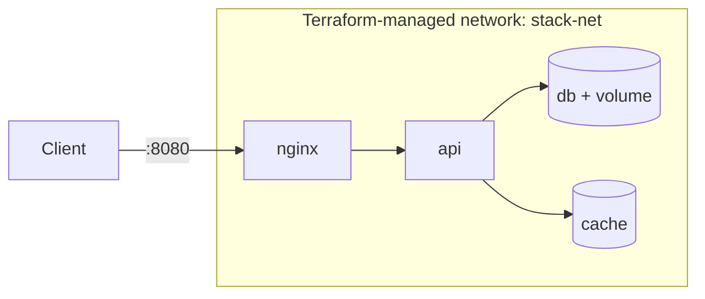
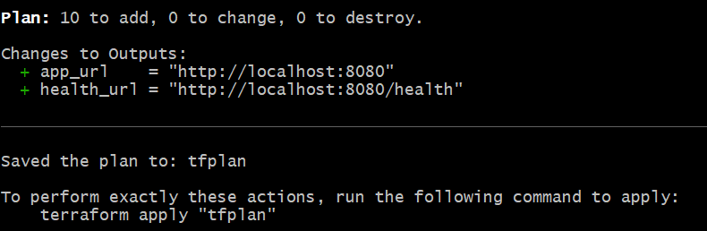
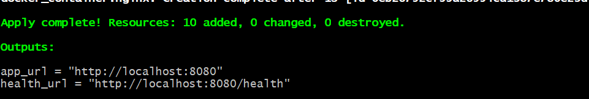
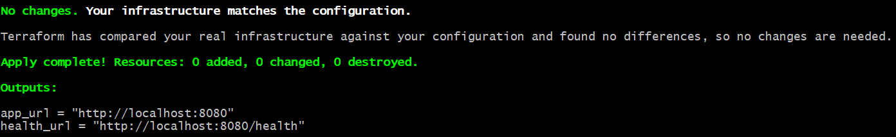
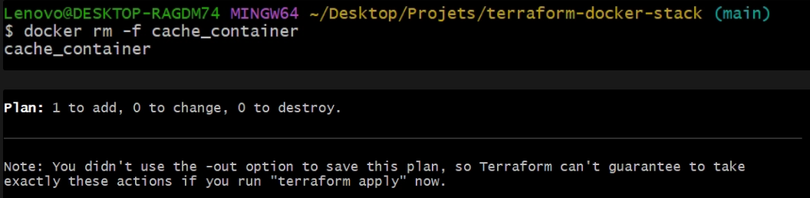

# terraform-docker-stack

The Weekend 2 stack (NGINX → Node API → PostgreSQL + Redis) described as Terraform code and provisioned on local Docker with the `kreuzwerker/docker` provider. One `terraform apply` creates it, one `terraform destroy` removes it.

## Architecture



## Run it

```bash
git clone https://github.com/najibHa/terraform-docker-stack.git
cd terraform-docker-stack
cp terraform.tfvars.example terraform.tfvars   # set your own db_password
terraform init
terraform plan
terraform apply
curl localhost:8080/health
terraform destroy
```

## Files

| File | Purpose |
|---|---|
| providers.tf | Terraform and provider versions |
| variables.tf | Inputs (password is `sensitive`) |
| main.tf | Network, volume, images, containers |
| outputs.tf | App and health URLs |

## Proof it works

| `terraform plan` | `terraform apply` + `docker ps` |
|---|---|
|  |  |

| Idempotent second apply | Drift detected after `docker rm -f` |
|---|---|
|  |  |

## Design decisions

- **Same architecture as Compose, expressed in HCL:** only `nginx` publishes a port.
- **`wait = true` on containers:** Terraform waits for a healthy container before creating dependents.
- **Variables for everything configurable:** the password is `sensitive` and comes from a git-ignored `tfvars`.
- **Pinned provider version (`~> 3.0`) and a committed lock file:** reproducible runs.
- **Read-only config mount:** NGINX can't modify the file on the host.
- **`keep_locally = true`:** `destroy` removes the containers but not the cached images.

## Learning value

- The Terraform workflow: init, plan, apply, destroy.
- Declarative vs. imperative: Terraform compares desired state with state and reality, and only changes the difference.
- Drift: manual changes are detected by `plan` and corrected by `apply`.
- State files hold secrets in plain text, so they never go in Git. Remote state is the next step.
- Terraform resource dependencies come from references (`docker_network.stack.name`) and `depends_on`.

## Known limitations

- The password is in the local state file in plain text.
- State is stored locally, so there is no locking and it can't be shared.
- Local Docker only. A cloud provider is a later step.

## Next steps

- Modules and remote state.
- Terraform validation and security scanning in CI.
- Swap the Docker provider for a cloud provider.
