# terraform-docker-stack


A Node API stack (NGINX → API → PostgreSQL + Redis) described as Terraform code and provisioned on local Docker with the `kreuzwerker/docker` provider.

- **Part 1 :** a single flat configuration, tagged [`v1`](../../tree/v1).
- **Part 2 :** the stack refactored into a reusable **module**, deployed as isolated **dev** and **prod** environments with **separate remote state** in MinIO (an S3-compatible server), and checked by **CI** on every push.

## Architecture

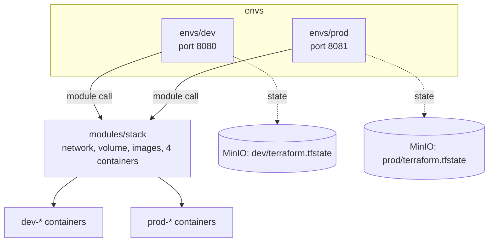

Inside each environment: `client → nginx → api → db + cache`. Only nginx publishes a port.

## Repo layout

```
terraform-docker-stack/
├── app/                  Node API and Dockerfile
├── nginx/                nginx.conf
├── minio/                compose file for the local S3-compatible backend
├── modules/stack/        the reusable stack (main.tf, variables.tf, outputs.tf)
├── envs/
│   ├── dev/              module call + provider + backend settings (port 8080)
│   └── prod/             same, with prod values (port 8081)
└── .github/workflows/    CI
```

| Location | Role |
|---|---|
| `modules/stack/` | The recipe. It declares inputs and never says "dev" or "prod". |
| `envs/*/main.tf` | A module call that fills in the inputs for one environment. |
| `envs/*/backend.hcl` | Backend settings (git-ignored, `.example` committed). |

## Run it

```bash
git clone https://github.com/najibHa/terraform-docker-stack.git
cd terraform-docker-stack

# 1. Start the remote backend (MinIO)
cd minio && cp .env.example .env     # set MinIO user and password
docker compose up -d && cd ..
# open http://localhost:9001 and create a bucket named "tfstate"

# 2. Credentials stay in environment variables, never in files
export AWS_ACCESS_KEY_ID=<minio user>
export AWS_SECRET_ACCESS_KEY=<minio password>

# 3. Deploy an environment
cd envs/dev
cp terraform.tfvars.example terraform.tfvars   # set your db_password
cp backend.hcl.example backend.hcl
terraform init -backend-config=backend.hcl
terraform plan
terraform apply
curl localhost:8080/health
```

Repeat in `envs/prod` (port 8081). Remove an environment with `terraform destroy` from its folder.

## Proof it works

### Part 2: modules, remote state, CI

| Both environments running | State of each env in MinIO |
|---|---|
| 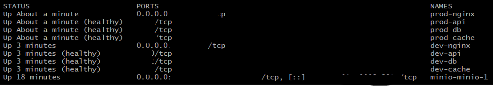 | 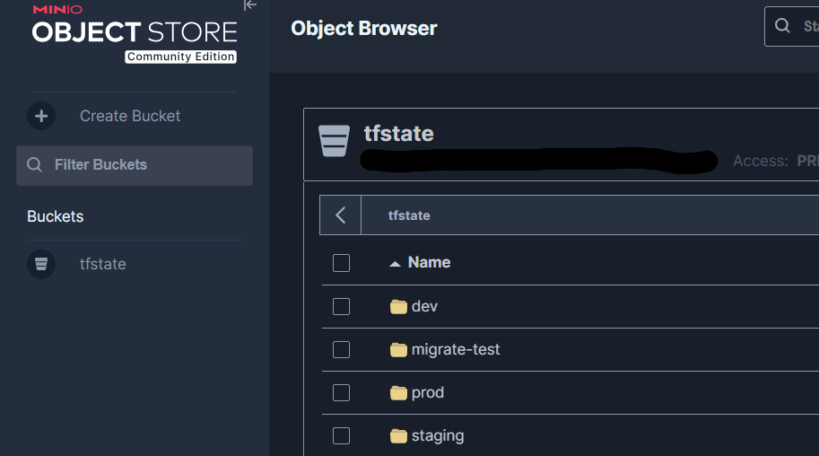 |

| Isolation: destroy dev, prod stays up | Lock error on concurrent apply |
|---|---|
| 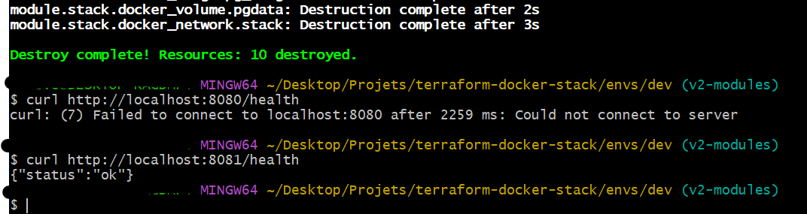 | 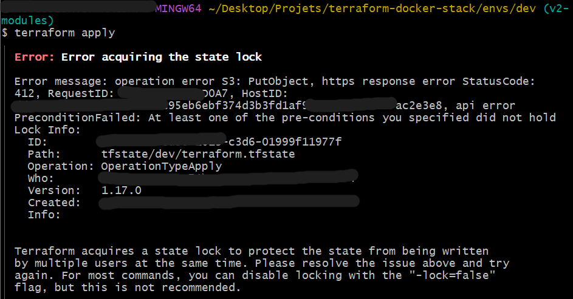 |

| State migration: before (local file) | State migration: after (MinIO) |
|---|---|
| 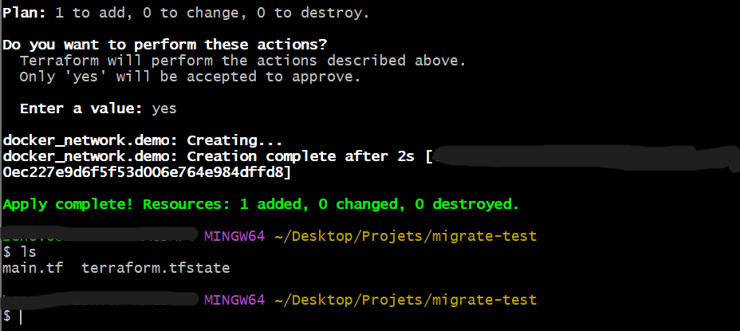 | 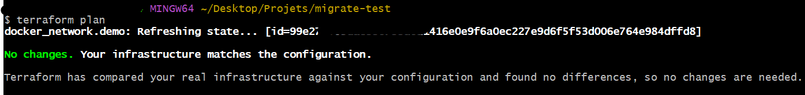 |

| CI red: formatting | CI red: undeclared variable |
|---|---|
| 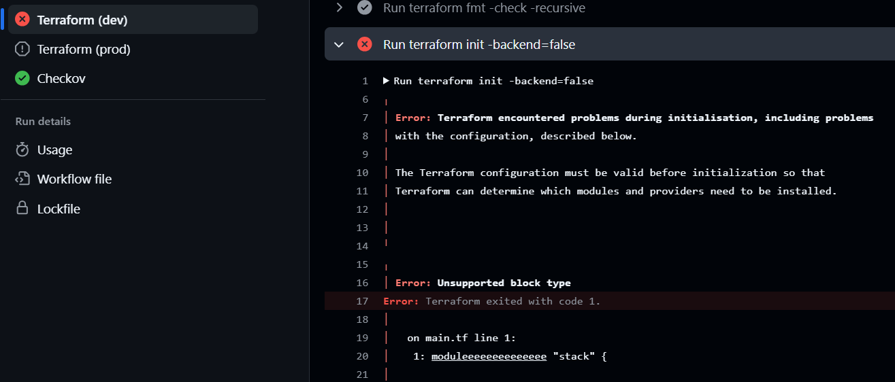 |  |

| CI green | Checkov: pip vs. action |
|---|---|
| 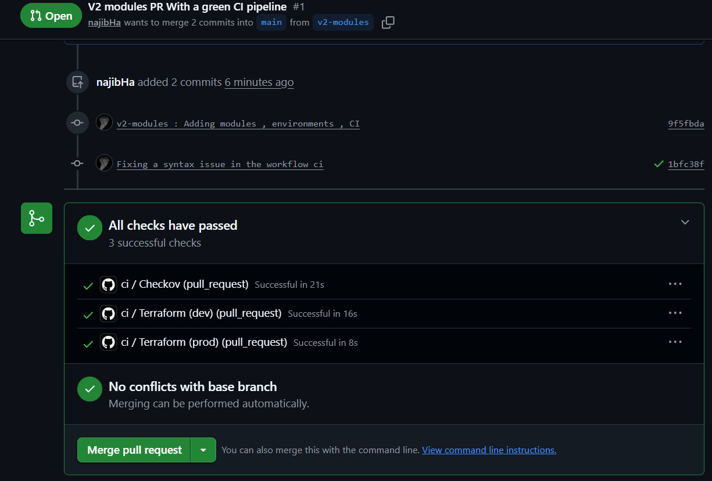 | 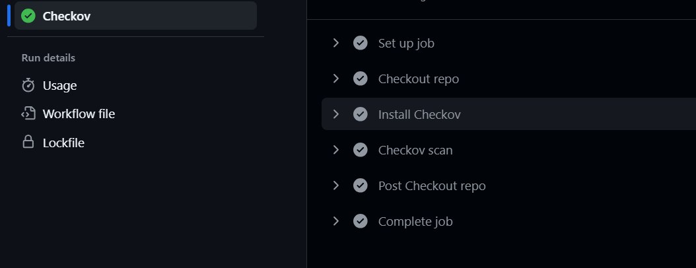 |

### Part 1: single configuration (Weekend 4)

| `terraform plan` | `terraform apply` + `docker ps` |
|---|---|
| 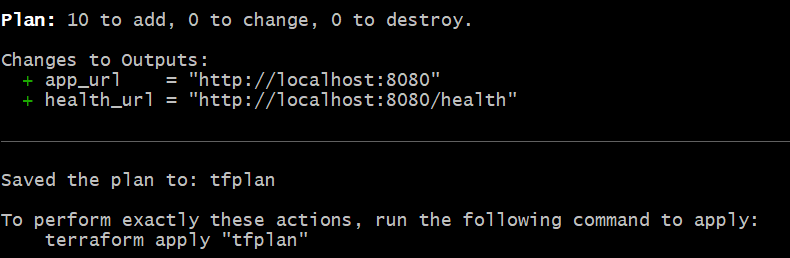 | 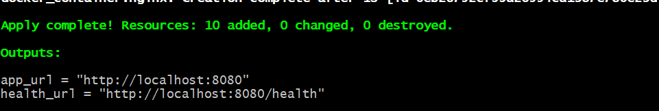 |

| Idempotent second apply | Drift detected after `docker rm -f` |
|---|---|
| 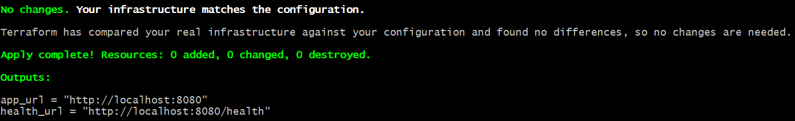 | 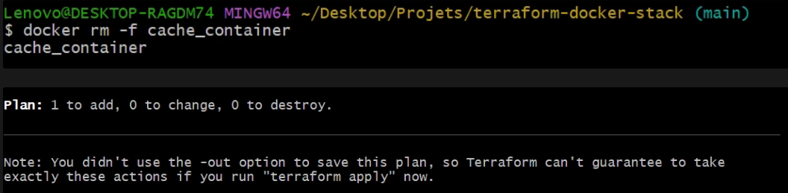 |

## Questions and answers

**What problem do modules solve, and what breaks if you copy-paste the stack for prod?**
A module defines the stack once, and each environment calls it with its own inputs (name, port, password). With copy-paste, every fix must be applied in each copy, and the copies slowly drift apart. Dev and prod would also collide on the same Docker host, because container, network and volume names and the published port must be unique. The module takes these as variables, so each environment passes its own.

**Why does each environment get its own state key?**
Each key is a separate state file, so an `apply` in dev can only change dev's resources. With a shared key, dev and prod would overwrite each other's state and Terraform would lose track of resources. Separate keys also allow separate access permissions per environment.

**Why can't the `backend` block use variables, and what did I do instead?**
Terraform initializes the backend before it evaluates variables, so the block must contain literal values only. I left the block empty (`backend "s3" {}`) and passed the settings at init time with `-backend-config=backend.hcl`. Credentials are never written to a file: they come from environment variables.

**What does state locking protect against?**
Two people or processes running `apply` on the same state at once. Without a lock, both read the same old state and the last write silently overwrites the other's changes. With locking, the second run fails immediately and shows who holds the lock.

**Why does CI run `init -backend=false`?**
The state backend (MinIO) runs on my laptop, so GitHub's runners can't reach it. `-backend=false` still downloads the providers, which is all that `fmt` and `validate` need.

## Design decisions

- **One module, many environments:** the stack exists once in `modules/stack`. A new environment costs one folder and about 15 lines.
- **Required inputs, no defaults:** environment name, port and paths have no defaults, so a forgotten value fails at plan time instead of silently colliding.
- **Environment prefix on names only:** container, network, volume and the locally built API image are prefixed (`dev-db`). Resource labels and network aliases stay plain, so `DB_HOST=db` works in every environment.
- **Provider configured by the environment, not the module:** the module declares `required_providers` and the env owns the `provider` block.
- **One state file per environment, with locking:** blast radius is limited to one environment.
- **No secrets in files:** the backend credentials are environment variables, and `backend.hcl` and `terraform.tfvars` are git-ignored with `.example` templates committed.
- **Checkov run two ways** (pip install and the official action) to compare setup, speed and reproducibility.
- **Part 1 kept intact** under the `v1` tag.

## Learning value

- A module is a reusable function: variables are parameters, outputs are return values, and a `module` block is the call.
- Module paths resolve relative to the module, so the caller passes absolute paths.
- State can be migrated to a new backend without rebuilding anything (`init -migrate-state`).
- Locking is per state file, so dev and prod never block each other.
- `uses` runs a packaged action, and `run` executes a shell command: two different step types.

## Known limitations

- MinIO runs on my laptop, so it simulates a cloud backend and gives no real durability or shared access.
- CI runs `fmt`, `validate` and Checkov but **no `plan`**: the backend and Docker daemon are local, so GitHub's runners can't reach them. With a cloud backend, the plan would run in CI and be posted on the PR.
- Passwords are still stored in plain text in the state, and the state is not encrypted at rest.
- Checkov's rules target mostly cloud resources, so it finds little in Docker-provider code.